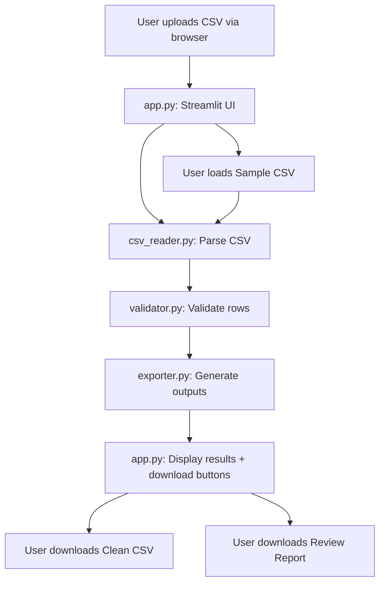

# Design Document: CSV Error Detective

## Overview

CSV Error Detective is a browser-based Python web application for wholesalers that validates supplier sales CSV files by detecting missing required values and exact duplicate rows. The application is built using **Streamlit** as the web framework, Python's standard library `csv` module for all CSV operations, and runs as a local web server on Windows (accessible via `http://localhost:8501`). It can also be hosted at a public URL for demonstrations without code changes.

**No pandas or DataFrame usage.** All data structures are native Python lists and dataclasses.

The application accepts a CSV file upload through the browser, validates each row against defined business rules, and produces two downloadable outputs:
1. **Clean CSV** — contains only rows that passed all validation checks
2. **Review Report** — contains all flagged rows with original row numbers and reasons

A synthetic sample CSV is bundled with the application to demonstrate functionality without requiring real data files.

### Key Design Principles

- **Simplicity**: Use only Python standard library modules (except Streamlit, pytest, and Hypothesis) and plain Python data structures
- **Single-pass validation**: O(n) time complexity for row-by-row processing
- **No file I/O for outputs**: All exports are built in memory using `io.StringIO`
- **Zero external dependencies for validation logic**: No paid APIs, cloud services, or network calls required

---

## Architecture

### Module Structure

The application consists of four Python modules:

```
csv-error-detective/
├── app.py              # Streamlit UI entry point
├── csv_reader.py       # CSV parsing and header extraction
├── validator.py        # Row validation and duplicate detection
├── exporter.py         # Clean CSV and review report generation
├── sample_data.csv     # Bundled sample CSV for demonstrations
├── requirements.txt    # Pinned dependencies
└── tests/
    ├── test_csv_reader.py
    ├── test_validator.py
    ├── test_exporter.py
    └── test_properties.py  # Property-based tests
```

**Module Responsibilities**:

1. **app.py** (Streamlit UI Entry Point)
   - Renders the web interface
   - Handles file upload widget
   - Triggers validation workflow
   - Displays validation results (counts, flagged rows)
   - Provides download buttons for Clean CSV and Review Report

2. **csv_reader.py** (CSV Parsing)
   - Reads uploaded CSV file using Python's standard-library `csv` module
   - Parses the file with UTF-8 encoding
   - Returns:
     - Column names (list of strings from header row)
     - Data rows (list of lists, where each inner list is a row of string values)
   - Handles malformed or empty files with descriptive error messages

3. **validator.py** (Validation Logic)
   - Receives column names and rows from csv_reader
   - Checks each row for:
     - Missing values in required columns
     - Exact duplicates (all column values identical)
   - Maintains a `seen` dictionary mapping `tuple(row_values)` → `first_occurrence_row_number` for O(1) duplicate detection
   - Returns a `ValidationResult` dataclass containing:
     - `clean_rows`: list of valid rows
     - `flagged_rows`: list of `FlaggedRow` dataclasses
     - `total_count`, `clean_count`, `flagged_count`

4. **exporter.py** (Output Generation)
   - Receives the `ValidationResult` from validator
   - Builds Clean CSV bytes in memory using `io.StringIO` + `csv.writer`
   - Builds Review Report CSV bytes in memory with two additional columns: `Original Row Number` and `Flag Reason`
   - Returns both outputs as bytes (ready for `st.download_button`)
   - No temporary files written to disk

### Data Flow



### Validation Algorithm

The validator performs a **single-pass O(n) traversal** over all data rows:

1. **Initialization**:
   - Create empty `seen` dictionary: `Dict[Tuple[str, ...], int]` mapping row value tuples to first occurrence row numbers (1-based)
   - Initialize empty lists for `clean_rows` and `flagged_rows`

2. **For each row** (starting at row number 1):
   - **Check for missing values**: Inspect each required column. A cell is a Missing_Value if it is empty, whitespace-only, or absent (row shorter than header).
   - **Check for duplicates**: Convert row to `tuple(row_values)` and look up in `seen` dictionary.
   - **Flagging logic**:
     - If row has missing values AND is a duplicate of a previously seen row: flag with combined reason (duplicate reason first, then missing reason).
     - If row has missing values only: flag with missing reason.
     - If row is a duplicate only (no missing values): flag with duplicate reason.
     - If row is valid (no missing, not a duplicate): add to `clean_rows` and register in `seen`.
   - **Register in `seen`**: If this is the first occurrence of this row tuple, add `(tuple(row_values), row_number)` to `seen` BEFORE processing subsequent rows.

3. **Row numbering**:
   - 1-based: first data row after the header is row 1.
   - Header row is not counted.

4. **Reason string formats**:
   - Missing only: `"Missing value in column(s): 'ColA', 'ColB'"`
   - Duplicate only: `"Exact duplicate of row N"` (where N is the first occurrence row number)
   - Duplicate + missing: `"Exact duplicate of row N; Missing value in column(s): 'ColA'"`

### Short Row Handling

When a row has fewer fields than the header:
- Use index-safe access: `row[i] if i < len(row) else ""` (or equivalent) when checking required columns.
- Absent cells in required columns are treated as Missing_Values.
- In the review report export, pad short rows with empty strings to ensure every row has exactly `len(columns)` values before appending `Original Row Number` and `Flag Reason`.

This prevents `IndexError` and ensures correct CSV structure in outputs.

---

## Components and Interfaces

### csv_reader.py

**Public API**:

```python
def read_csv(file_obj) -> Tuple[List[str], List[List[str]]]:
    """
    Reads a CSV file object and returns column names and data rows.

    Args:
        file_obj: A file-like object (e.g., uploaded file from Streamlit)

    Returns:
        Tuple of (column_names, data_rows)
        - column_names: List of strings from header row
        - data_rows: List of lists, each inner list is a row of string values

    Raises:
        ValueError: If file is empty, malformed, or has no header
    """
```

**Implementation Notes**:
- Use `csv.reader(file_obj)` with UTF-8 encoding.
- First row is the header.
- All subsequent rows are data rows.
- Preserve original cell values without modification.

---

### validator.py

**Data Structures**:

```python
@dataclass
class FlaggedRow:
    row_number: int          # 1-based row number (first data row = 1)
    row_values: List[str]    # Original cell values
    reason: str              # Human-readable reason string

@dataclass
class ValidationResult:
    clean_rows: List[List[str]]    # Rows with no issues
    flagged_rows: List[FlaggedRow] # Rows with issues
    total_count: int               # Total rows processed
    clean_count: int               # Count of clean rows
    flagged_count: int             # Count of flagged rows
```

**Public API**:

```python
def validate_rows(
    column_names: List[str],
    data_rows: List[List[str]]
) -> ValidationResult:
    """
    Validates rows for missing values and duplicates.

    Args:
        column_names: List of column names from header
        data_rows: List of data rows (each row is a list of strings)

    Returns:
        ValidationResult containing clean rows, flagged rows, and counts

    Raises:
        ValueError: If required columns are missing from column_names
    """
```

**Constants**:

```python
REQUIRED_COLUMNS = [
    "Invoice Number",
    "Invoice Date",
    "Supplier Name",
    "Product Code",
    "Product Description",
    "Quantity",
    "Unit Price",
    "Total Amount"
]
```

**Validation Rules**:

1. **Missing Value Detection**:
   - A cell is a Missing_Value if: `cell.strip() == ""` (empty or whitespace-only) or the cell index is out of bounds (row shorter than header).
   - When a row has missing values in N required columns, report all N column names in the reason string in header order.

2. **Duplicate Detection**:
   - Convert each row to `tuple(row_values)` for hashable comparison.
   - Use a `seen: Dict[Tuple[str, ...], int]` dictionary to track first occurrence row numbers.
   - A row is an Exact_Duplicate if its tuple already exists in `seen` AND it is not the first occurrence.
   - The duplicate reason always references the **first occurrence row number**, not the previous duplicate.

3. **First Occurrence Rules**:
   - If the first occurrence of a row has no missing values, it appears in Clean CSV.
   - If the first occurrence has missing values, it is flagged for missing values only (NOT flagged as a duplicate).
   - All subsequent identical rows are flagged as duplicates (and also flagged for missing values if applicable).

4. **Combined Reasons**:
   - When a row is both a duplicate AND has missing values, join both reasons: `"Exact duplicate of row N; Missing value in column(s): 'ColA'"`

---

### exporter.py

**Public API**:

```python
def generate_clean_csv(
    column_names: List[str],
    clean_rows: List[List[str]]
) -> bytes:
    """
    Generates the Clean CSV output in memory.

    Args:
        column_names: Header row
        clean_rows: Rows that passed validation

    Returns:
        CSV content as bytes (UTF-8 encoded)
    """

def generate_review_report(
    column_names: List[str],
    flagged_rows: List[FlaggedRow]
) -> bytes:
    """
    Generates the Review Report CSV in memory.

    Args:
        column_names: Original header columns
        flagged_rows: Rows that were flagged during validation

    Returns:
        CSV content as bytes (UTF-8 encoded) with two extra columns:
        'Original Row Number' and 'Flag Reason'
    """
```

**Implementation Notes**:
- Use `io.StringIO()` + `csv.writer()` to build CSV in memory.
- For the review report:
  - Header: `column_names + ["Original Row Number", "Flag Reason"]`
  - For each flagged row: pad short rows with empty strings to ensure `len(row_values) == len(column_names)`, then append `row_number` and `reason`.
- Convert `StringIO` to bytes using `.getvalue().encode('utf-8')`.
- No files written to disk.

---

### app.py

**UI Flow**:

1. **Title and Instructions**:
   - Display application name and brief description.
   - Show option to upload a CSV file or load the bundled sample CSV.

2. **File Upload**:
   - `st.file_uploader()` widget that accepts `.csv` files only.
   - If a non-CSV file is selected, display error message.
   - Button to load the bundled `sample_data.csv`.

3. **Validation Trigger**:
   - When a file is uploaded or sample is loaded:
     - Call `csv_reader.read_csv()` to parse the file.
     - Call `validator.validate_rows()` to perform validation.
     - Display results summary: total rows, clean count, flagged count.

4. **Results Display**:
   - If flagged rows exist, display them in a table (row number, row values, reason).
   - Sort flagged rows by ascending row number.

5. **Download Buttons**:
   - `st.download_button()` for Clean CSV:
     - Filename: `clean_output.csv`
     - MIME type: `text/csv`
   - `st.download_button()` for Review Report:
     - Filename: `review_report.csv`
     - MIME type: `text/csv`
   - If all rows are flagged, the Clean CSV contains only the header (notice displayed).
   - If no rows are flagged, the Review Report contains only the header (notice displayed).

---

## Data Models

### FlaggedRow

```python
@dataclass
class FlaggedRow:
    row_number: int          # 1-based row number (header excluded)
    row_values: List[str]    # Original cell values
    reason: str              # Human-readable reason string
```

### ValidationResult

```python
@dataclass
class ValidationResult:
    clean_rows: List[List[str]]    # Rows that passed all checks
    flagged_rows: List[FlaggedRow] # Rows that failed one or more checks
    total_count: int               # Total data rows processed
    clean_count: int               # Number of clean rows
    flagged_count: int             # Number of flagged rows
```

---

## Correctness Properties

*A property is a characteristic or behavior that should hold true across all valid executions of a system — essentially, a formal statement about what the system should do. Properties serve as the bridge between human-readable specifications and machine-verifiable correctness guarantees.*

### Property 1: UTF-8 Round-Trip Preservation

*For any* set of valid rows with arbitrary string content, when the csv_reader writes the rows to a CSV file in UTF-8 encoding and then reads them back, the resulting string values SHALL be identical to the originals.

**Validates: Requirements 1.3**

---

### Property 2: Whitespace-Only Cell Detection

*For any* cell value composed entirely of whitespace characters (spaces, tabs, newlines), the validator SHALL treat it as a Missing_Value.

**Validates: Requirements 2.3**

---

### Property 3: Missing Column Completeness

*For any* row missing N required columns (N ≥ 1), the validator SHALL produce a reason string that names all N missing column names in header order.

**Validates: Requirements 3.2, 3.3**

---

### Property 4: 1-Based Row Numbering

*For any* CSV file with at least one data row, the first data row after the header SHALL be assigned row number 1 in all flagged row outputs.

**Validates: Requirements 3.4**

---

### Property 5: Duplicate-Only Reason for Valid Duplicates

*For any* two identical rows with no missing values at positions p1 < p2, the validator SHALL include row p1 in the clean output and SHALL flag row p2 with the reason `"Exact duplicate of row 1"`.

**Validates: Requirements 4.2, 4.4**

---

### Property 6: Missing-Only Reason Format

*For any* row with exactly one missing required value and no duplicates, the validator SHALL produce a reason string in the exact format `"Missing value in column(s): 'ColName'"`.

**Validates: Requirements 3.2**

---

### Property 7: Combined Reason Format for Duplicate with Missing Values

*For any* subsequent duplicate row that also contains one or more missing values, the validator SHALL produce a combined reason string with the duplicate reason first, followed by `"; "`, followed by the missing reason: `"Exact duplicate of row N; Missing value in column(s): 'ColA'"`.

**Validates: Requirements 4.6, 5.3**

---

### Property 8: Combined Reason References First Occurrence

*For any* row flagged with a combined reason (duplicate + missing), the row number N in the duplicate part of the reason SHALL reference the first occurrence of that row, not the current row or any intermediate duplicate.

**Validates: Requirements 4.3**

---

### Property 9: Three Identical Rows — First Occurrence Rule

*For any* three identical valid rows at positions p1 < p2 < p3, the clean output SHALL contain exactly one copy (row p1), and both row p2 and row p3 SHALL be flagged with reasons referencing row p1: `"Exact duplicate of row 1"`.

**Validates: Requirements 4.2, 4.3**

---

### Property 10: Short Row Missing Value Detection

*For any* row with fewer fields than the header, the validator SHALL flag it for the missing required columns it is short on, and SHALL NOT raise an `IndexError`.

**Validates: Requirements 2.3**

---

### Property 11: Count Invariant

*For any* set of input rows, the sum of clean_count and flagged_count SHALL equal the total number of rows processed.

**Validates: Requirements 5.1**

---

### Property 12: Sort Order of Flagged Rows

*For any* set of flagged rows, the review report SHALL list them in ascending order of their original row numbers.

**Validates: Requirements 5.4, 7.4**

---

### Property 13: Clean Output Integrity

*For any* input data, no row that appears in the review report (flagged rows) SHALL appear in the clean CSV output.

**Validates: Requirements 4.7, 6.3**

---

### Property 14: Review Report Schema Consistency

*For any* flagged row, the corresponding row in the review report CSV SHALL have exactly `len(column_names) + 2` fields (the original columns plus `Original Row Number` and `Flag Reason`).

**Validates: Requirements 7.2, 7.3**

---

## Error Handling

### File Upload Errors

- **Non-CSV file selected**: Display error message `"Only CSV files are accepted."` and prevent processing.
- **File system read error**: Display descriptive error message (e.g., `"Unable to read file: [reason]"`) and allow user to select a different file.
- **Empty or malformed CSV**: Display error message `"The file is empty or malformed."` and halt processing.

### Missing Required Columns

- When the uploaded CSV does not contain one or more required columns in the header row, display error message listing the missing column names:
  ```
  Missing required columns: 'Invoice Number', 'Supplier Name'
  ```
- Halt processing until a valid file is uploaded.

### Validation Errors

- All validation issues (missing values, duplicates) are captured in the `ValidationResult` and displayed to the user.
- No exceptions are raised during validation; all flagged rows are reported in the review report.

### Empty Output Scenarios

- **All rows flagged**: Clean CSV contains only the header row. Display notice: `"No clean rows found."`
- **No rows flagged**: Review Report contains only the header row. Display notice: `"No flagged rows found."`

---

## Testing Strategy

### Unit Testing

**Framework**: pytest 8.3.5

Unit tests verify specific examples, edge cases, and error conditions:

- **csv_reader.py**:
  - Valid CSV parsing with UTF-8 encoding
  - Empty file error
  - Malformed CSV error
  - File with no data rows
- **validator.py**:
  - Missing required columns in header (error case)
  - Single missing value in one column
  - Multiple missing values in one row
  - First occurrence of duplicate with no missing values (included in clean)
  - First occurrence of duplicate with missing values (flagged for missing only)
  - Subsequent duplicate with no missing values (flagged for duplicate only)
  - Subsequent duplicate with missing values (combined reason)
  - Empty result (no rows flagged)
  - All rows flagged
- **exporter.py**:
  - Clean CSV generation with valid rows
  - Review report generation with flagged rows
  - Empty clean output (header only)
  - Empty review report (header only)
  - Short row padding in review report
- **app.py**:
  - File upload widget accepts `.csv` extension only
  - Sample CSV loads correctly
  - Results display shows correct counts
  - Download buttons deliver correct files

### Property-Based Testing

**Framework**: Hypothesis 6.165.0

**Configuration**: Minimum 100 iterations per property test.

Each property-based test MUST include a comment tag referencing its design property:

```python
# Feature: csv-error-detective, Property 1: UTF-8 Round-Trip Preservation
@given(st.lists(st.lists(st.text())))
def test_utf8_round_trip(rows):
    ...
```

**Property Tests**:

1. **P1: UTF-8 Round-Trip** — Generate arbitrary rows of string values, encode as UTF-8 CSV, read back, verify values match.
2. **P2: Whitespace Detection** — Generate strings of only whitespace characters, verify flagged as missing values.
3. **P3: Missing Column Completeness** — Generate rows missing any subset of required columns, verify all missing columns named in reason.
4. **P4: 1-Based Row Numbering** — Generate any flagged row as the first data row, verify row number is 1.
5. **P5: Duplicate-Only Reason** — Generate two identical valid rows, verify second is flagged with `"Exact duplicate of row 1"` and first is in clean output.
6. **P6: Missing-Only Reason** — Generate a row with one missing required value, verify reason format.
7. **P7: Combined Reason** — Generate a valid row and a duplicate with a missing value, verify combined reason format.
8. **P8: Combined Reason Row Reference** — Generate a duplicate with missing values, verify the duplicate reason references the first occurrence row number.
9. **P9: Three Identical Rows** — Generate three identical valid rows, verify clean output contains exactly one, both later rows reference row 1.
10. **P10: Short Row** — Generate a row with fewer fields than the header, verify flagged for missing required columns without `IndexError`.
11. **P11: Count Invariant** — For any input, verify `clean_count + flagged_count == total_count`.
12. **P12: Sort Order** — Generate flagged rows in random order, verify review report lists them in ascending row number order.
13. **P13: Clean Output Integrity** — For any input, verify no flagged row appears in clean CSV.
14. **P14: Review Report Schema** — For any flagged row, verify the review report row has exactly `len(columns) + 2` fields.

### Integration Testing

- **End-to-end validation workflow**: Upload sample CSV, trigger validation, verify output files match expected results.
- **Streamlit UI**: Manual testing of file upload, results display, and download buttons.
- **Windows deployment**: Smoke test verifying application starts on `localhost:8501` on Windows 10/11.

### Test Coverage Goals

- **Unit tests**: ≥90% code coverage for `csv_reader.py`, `validator.py`, `exporter.py`.
- **Property tests**: All 14 correctness properties implemented with ≥100 iterations each.
- **Integration tests**: At least one end-to-end test covering the complete workflow.

---

## Dependencies

**Runtime Dependencies**:

- `streamlit==1.46.0` — Web framework for UI
  - Supports Python 3.11 and 3.12 on Windows
  - Latest stable release (June 2025)

**Test Dependencies**:

- `pytest==8.3.5` — Unit test runner
- `hypothesis==6.165.0` — Property-based testing library

**Python Version Compatibility**:

- **Supported**: Python 3.11, Python 3.12
- **Platform**: Windows 10, Windows 11 (no admin privileges required)

**requirements.txt**:

```
streamlit==1.46.0
pytest==8.3.5
hypothesis==6.165.0
```

All other functionality uses Python standard library modules:
- `csv` (CSV parsing and writing)
- `io` (in-memory file operations)
- `dataclasses` (data structures)
- `typing` (type annotations)

---

## Deployment

### Local Windows Deployment

**Prerequisites**:
- Python 3.11 or 3.12 installed
- `pip` package manager

**Setup**:
```powershell
# Clone or extract the application
cd csv-error-detective

# Install dependencies
pip install -r requirements.txt
```

**Run**:
```powershell
streamlit run app.py
```

The application will start a local web server at `http://localhost:8501` (default port).

**Configuration**:
- Default port: 8501 (configurable via Streamlit CLI arguments: `streamlit run app.py --server.port 8080`)
- No administrator privileges required
- No external network calls required for validation functionality

### Public Deployment (Streamlit Community Cloud)

The application is fully compatible with Streamlit Community Cloud deployment:

1. Push the repository to GitHub.
2. Deploy via Streamlit Community Cloud (free tier).
3. The application will be accessible at a public URL with zero code changes.

**Deployment Notes**:
- All validation and export logic runs server-side.
- No environment variables or secrets required.
- Sample CSV is included in the repository.

---

## Sample CSV

**Location**: `sample_data.csv` (bundled in the application root directory)

**Structure**: Conforms to the Supplier_Sales_CSV format defined in Requirements.

**Contents**:
- At least 15 data rows
- At least 3 rows with one or more missing values across different required columns
- At least 2 rows that are exact duplicates of earlier rows
- At least 8 rows that are fully valid (will appear in clean output)

**Usage**:
- When the user clicks "Load Sample CSV" in the UI, the application loads `sample_data.csv` into the validation workflow as if the user had uploaded it manually.

---

## Future Enhancements (Out of Scope)

The following features are not included in this design but could be added in future iterations:

- **Custom required columns**: Allow users to define their own required columns via UI.
- **Export to Excel**: Provide `.xlsx` format as an alternative to CSV.
- **Batch processing**: Support uploading and validating multiple CSV files at once.
- **Advanced duplicate detection**: Detect "fuzzy" duplicates (similar but not identical rows).
- **Data type validation**: Validate that numeric columns contain valid numbers, date columns contain valid dates, etc.
- **Detailed analytics**: Provide charts and statistics on validation results (e.g., most common missing columns).
